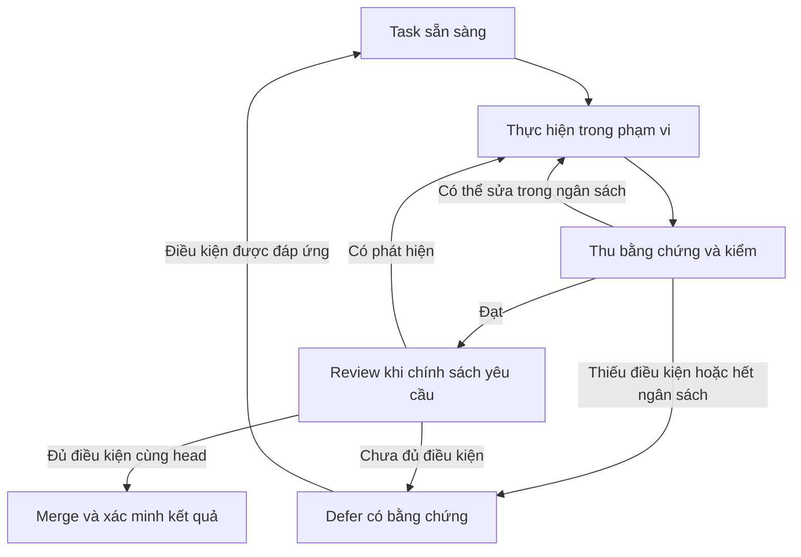

# Kế hoạch khắc phục và nâng cấp tự động hóa X-Templates

> Ngày: 2026-10-19 · Trạng thái: đề xuất để review · Phạm vi PR: tài liệu kế hoạch.
> Mục tiêu: tăng tỷ lệ công việc tự hoàn tất, đồng thời giữ bằng chứng đáng tin cho kết luận đạt, review và merge.

## 1. Mốc đánh giá và cách dùng

Đánh giá kỹ thuật được thực hiện trên [v3.7.1, commit `9433792`][baseline]. Nhánh tài liệu được tạo từ
[`19d3aa8`, PR #158][delta], sau khi đối chiếu thay đổi mới trên `main`. PR #158 bổ sung báo cáo audit, kế hoạch
thực thi và tăng giới hạn lượt của subagent; `scripts/xt.py`, `scripts/install.py` và `.claude/hooks/guard.py`
không đổi giữa hai mốc. Các tái hiện dưới đây thuộc mốc đánh giá, không phải kết quả kiểm thử của bản sửa tương lai.

[PLAN đang thực thi](../autopilot/PLAN.md), [sổ audit](AUDIT-STATUS.md) và
[báo cáo delta ngày 2026-10-19](AUDIT-REPORT-2026-10-19-delta.md) là nơi theo dõi các task/phát hiện đã có.
Tài liệu này bổ sung hướng sửa và nâng cấp; các mục trùng được ánh xạ về task hiện hữu ở §3. Khi triển khai,
đối chiếu lại HEAD, bổ sung tiêu chí vào task tương ứng, chỉ cấp task/ID audit mới cho phần thực sự còn thiếu.
Không dùng bảng này làm một sổ hoàn thành thứ hai.

PR kế hoạch không sửa mã, quyền, workflow, ruleset, phiên bản phát hành hay trạng thái đã sửa trong sổ audit.
Các CLI/schema mang nhãn **đề xuất** chưa tồn tại. Việc chấp nhận tài liệu là chấp nhận hướng và thứ tự ưu tiên;
mỗi thay đổi hành vi vẫn cần PR riêng, bằng chứng kiểm tra và quy trình merge hiện hành.

## 2. Hướng nâng cấp được khuyến cáo

Ưu tiên bảo toàn tính đúng của cổng và bằng chứng trước khi cho bộ điều phối tự xử lý thêm nhiều việc.
Sau đó tự động hóa việc chọn yêu cầu, tạo gói ngữ cảnh, thu bằng chứng, yêu cầu review, sửa CI và khôi phục phiên.
Chính sách tự chủ hiện có tiếp tục áp dụng; các hành động hợp lệ không phải hỏi lại chỉ vì chuyển sang bước mới.

Ba nguyên tắc thiết kế:

- **Mỗi lần chuyển trạng thái có điều kiện máy kiểm được.** Thiếu blueprint đã khai báo, bằng chứng cũ hoặc chưa có
  review hợp lệ phải tạo công việc cần hoàn tất; không được suy ra là đạt.
- **Tự sửa trong phạm vi được giao.** Phân biệt lỗi sản phẩm, lỗi môi trường và lỗi tạm thời; sửa có kiểm chứng,
  giới hạn số lần thử, thời gian và chi phí. Hết khả năng thì giữ bằng chứng và tiếp tục task độc lập.
- **Một chính sách, nhiều điểm thực thi.** CLI, hook và steward cùng sử dụng quyết định có cấu trúc. Review,
  CI và quyền production được kiểm theo repository/PR/head/phạm vi thực tế, có nguồn bằng chứng xác định.

Giữ Python >= 3.11 và thư viện chuẩn cho runtime theo [AGENTS](../../AGENTS.md). Duy trì cổng của
[xt.yaml](../../xt.yaml), kiểm tra trên Python 3.11/3.13 ở CI, coverage dòng và nhánh 100%, lint và typecheck.
Coverage hiện có là tài sản cần giữ; bổ sung các kiểm tra bất biến giữa nhiều thành phần để phát hiện điều kiện
nghiệm thu sai ngay cả khi từng nhánh mã đều đã được chạy.

## 3. Danh mục ưu tiên và quan hệ với kế hoạch hiện có

P1: sửa trước khi mở rộng tự merge hoặc phạm vi tự chủ. P2: hoàn thiện độ tin cậy và khả năng áp dụng.
P3: cải thiện cấu trúc, vận hành và hiệu suất sau nền tảng. Đây là thứ tự triển khai của kế hoạch này,
không thay đổi mức độ nghiêm trọng đã ghi trong sổ audit.

| Mục | Ưu tiên | Vấn đề / kết quả mong muốn | Quan hệ với PLAN tại `19d3aa8` |
|---|---|---|---|
| REC-01 | P1 | Không tái sử dụng kết quả giữa hai lệnh shell khác nghĩa | Bổ sung mới; không được bao phủ bởi T-1415 |
| REC-02 | P1 | Blueprint đã khai báo bị mất/hỏng không làm vòng lặp hoàn tất hoặc mất sàn Gate | Bổ sung mới |
| REC-03 | P1 | Review, CI, guard và steward thống nhất điều kiện merge trên head hiện tại | Mở rộng T-1408/1409/1411; liên quan AUD-SEC-069, AUD-HAR-058/059 |
| REC-04 | P1 | Quyết định guard có kiểu và mã lý do; giữ hành động bị chặn qua mọi lớp | Mở rộng T-1402 và đợt guard; liên quan AUD-SEC-063/070 |
| REC-05 | P1 | Yêu cầu bảo mật thiết yếu không bị hạ chỉ để đủ trần MUST | Bổ sung mới; cần ADR về cách chọn yêu cầu |
| REC-06 | P2; P1 nếu yêu cầu bảo mật đổi | Bằng chứng gắn với phiên bản nội dung yêu cầu | Bổ sung mới; khác việc sửa văn bản bằng chứng trong T-1415 |
| REC-07 | P2 | N/A được đánh giá lại khi khả năng hoặc phạm vi dự án thay đổi | Bổ sung mới |
| REC-08 | P2 | Check bắt buộc thực thi phải thật sự SUCCESS đúng nguồn và SHA | Mở rộng T-1409; phân biệt với chỉ loại `merge-gate` khỏi bằng chứng kiểm mã |
| REC-09 | P2 | Cài/nâng khung giữ chính sách quyền của dự án có sẵn, có nguồn gốc thay đổi | Bổ sung mới; chủ yếu `install.py` |
| REC-10 | P2 | Tài liệu phản ánh thống nhất chính sách tự chủ hiện hành | Gộp vào T-1415; liên quan AUD-DOC-044/045/048/050 |
| REC-11 | P2 | Chọn đúng yêu cầu và chỉ nạp ngữ cảnh cần cho task | Bổ sung mới; dữ liệu số đếm liên quan AUD-DOC-048 |
| REC-12 | P3 | Tách dần trách nhiệm trong CLI/guard, giữ hợp đồng bên ngoài | Liên quan AUD-ARCH-001; hiện nằm ngoài đợt 3.8.0 |
| REC-13 | P2/P3 | Theo dõi nguồn, liên kết và mức độ đã xác minh | Liên quan AUD-CI-011; mở rộng sau sửa tài liệu T-1415 |

Những việc khác đã có trong T-1403…1414, như brace expansion, cách ly Python, prefix dự án con,
`contrast`, `vendor-check` và `perf guard`, tiếp tục theo PLAN hiện hữu. Sự vắng mặt của chúng trong danh mục
bổ sung không có nghĩa là giảm ưu tiên hoặc đã hoàn tất.

## 4. Các gói khắc phục có thể triển khai

### REC-01 — Danh tính lệnh và tái sử dụng kết quả

**Bằng chứng:** [same_command][commands] dùng `shlex.split`; cách này bỏ khác biệt giữa nháy đơn và nháy kép.
Trong fixture với `XT_REVIEW_VALUE=yes`, lệnh `test "$XT_REVIEW_VALUE" = yes` trả 0, còn
`test '$XT_REVIEW_VALUE' = yes` trả 1. Máy so lệnh coi chúng bằng nhau; đường kiểm blueprint trả `[0, 0]`
và `loop verify` có thể trả đạt sau khi chỉ chạy một Gate. Đây là tái hiện cục bộ bằng lệnh vô hại.

**Hướng sửa:** giữ nguyên ngữ nghĩa shell trong danh tính lệnh; tách argv có cấu trúc khỏi shell script.
Chỉ tái sử dụng khi chứng minh được cùng lệnh, cơ chế chạy, thư mục và ngữ cảnh đầu vào còn hiệu lực;
khi không chứng minh được thì chạy lại. Không dùng bản lệnh đã che bí mật làm khóa duy nhất.

**Nghiệm thu:** cặp lệnh trên phải chạy riêng và tổng kiểm tra phải đỏ; có ca biến môi trường, glob,
escape, thư mục khác và đầu vào đổi. Kiểm cả cache trong blueprint, đối chiếu evidence với Gate và sàn Gate.
Vẫn che bí mật ở log. Bằng chứng/verified cũ thiếu định danh mới được giữ để truy vết nhưng phải chạy lại.

### REC-02 — Hợp đồng phạm vi tồn tại suốt vòng lặp

**Bằng chứng:** [_verdict_blueprint][blueprint], [_verify_blueprint][verify-blueprint] và [blueprint_scale / gate_floor_keys][floor]
không giữ ràng buộc khi file đã khai báo biến mất. Fixture có blueprint web M, một MUST mở và task đã xanh:
trước khi xóa, verdict tiếp tục và còn ba thiếu sót về sàn Gate; sau khi xóa, verdict có thể thành `done`,
sàn Gate rỗng và verify trả 0. Khởi tạo với đường dẫn không tồn tại đã bị chặn; lỗi ở thời điểm sau khởi tạo.

**Hướng sửa:** lưu hợp đồng phạm vi khi init: có/không khai blueprint, đường dẫn, profile, scale và revision.
Mất/hỏng file đã khai báo phải đưa về cần xác minh hoặc bị chặn, giữ sàn kiểm đã biết. Thay đổi phạm vi
đi qua thao tác có chủ đích, có lịch sử, không được suy diễn từ việc xóa file.

**Nghiệm thu:** kiểm mất file, đổi tên, nội dung/frontmatter hỏng, thay scale/profile và state phiên bản cũ.
Không trường hợp thiếu dữ kiện nào tự rơi về `done` hoặc S/không áp dụng. Khôi phục file hợp lệ phải tiếp tục
được; dự án thật sự không khai blueprint từ đầu vẫn theo hợp đồng riêng. Migration không reset toàn bộ task.

### REC-03 — Một điều kiện merge, review có nguồn xác thực

**Bằng chứng:** fixture PR làn chuẩn, L3, CI xanh, không có review: [merge_decision][merge-policy] trả merge,
trong khi [pr_next][review-policy] yêu cầu review; guard và `merge-gate` không ép cùng điều kiện review.
Đây là kiểm thử hàm/đầu vào giả, không phải bằng chứng đã merge trái phép trên GitHub. Quy tắc nhánh vẫn
bảo vệ những điều kiện được cấu hình. T-1408/1411 đã có trong PLAN để xử lý một phần bài toán nguồn và hiệu lực review.

**Hướng sửa:** tạo điều kiện review độc lập có dữ liệu repository, PR, head, kết luận, nguồn và thời điểm.
Dùng cùng điều kiện ở CLI, guard, steward và required gate. Mã điều khiển lấy từ ref/SHA đã được chính sách
cho phép, không chạy code PR hoặc ref dispatch tùy ý với quyền ghi. Marker comment
hoặc tên người đánh giá tự khai không đủ để chứng minh có review độc lập; collector phải kiểm chủ thể phát hành
và quyền tương ứng. Không cho tác giả sửa mã tự tạo bằng chứng review sạch trong cùng vùng quyền ghi.

**Nghiệm thu:** chưa review, review cũ, blocking trên head hiện tại, push sau khi bật auto-merge, đổi repo/PR,
review đến sai thứ tự, giả nguồn và cập nhật base đều có ca hồi quy. Giữ quy tắc mang review qua merge base
chỉ khi chứng minh phần cần review không đổi; blocking chưa được giải quyết trên head hiện tại thắng review cũ.
Review sạch mới hơn, hợp lệ ngay trên head đó có thể giải các phát hiện sau khi xác minh chúng đã được xử lý.
Kiểm lại head ngay trước thao tác merge; dùng ghim SHA hoặc cơ chế tương đương bảo vệ lần cập nhật đó.

Required gate kiểm review phải tách khỏi việc đợi tổng hợp CI: không chờ chính check đang chạy và không
tính check chỉ kiểm chính sách là bằng chứng test mã. Có test gate của chính workflow đang IN_PROGRESS vẫn
kết thúc được khi điều kiện review đạt và các check kiểm mã còn pending; bộ tổng hợp merge cuối mới đòi gate đó SUCCESS.
Kết quả gate chứng nhận đúng PR head được đánh giá, dù mã điều khiển lấy từ ref tin cậy khác; xanh ở base/head cũ
không được dùng cho head mới.
Bằng chứng review trước migration cần kiểm nguồn lại;
thiếu nguồn thì tự xếp một lượt review mới, không tự nâng thành sạch. Cần ADR trước khi đổi cơ chế chứng thực.

### REC-04 — Guard trả quyết định có cấu trúc

**Bằng chứng:** [apply_policy][guard-policy] chuyển `ask` thành deny hay cho chạy dựa vào từ khóa trong
lời giải thích. Payload shell lồng quá trần có thể đi từ `ask` sang cho chạy; đã tái hiện qua hook thật
và được ghi riêng tại AUD-SEC-063. Đường ghi evidence qua bí danh cũng cho thấy giới hạn của quét chuỗi.

**Hướng sửa:** quyết định gồm hành động, mã lý do, mức chắc chắn và điều kiện còn thiếu. Chính sách no-ask
ánh xạ theo loại hành động và lý do; lỗi phân tích, hết ngân sách hoặc không kiểm hết hành động thuộc phạm vi
cần chặn phải giữ kết quả chặn qua mọi adapter. T-1402 có thể sửa lỗ cụ thể trước; typed decision là bước tiếp
theo để tránh lỗi cùng lớp, không cần đợi refactor toàn guard.

**Nghiệm thu:** cùng hành động qua Bash/MCP/hook có kết quả nhất quán, không phụ thuộc câu thông báo hoặc
ngôn ngữ; có test chính sách mặc định, strict, lồng shell, parse lỗi, alias và corpus lệnh hợp lệ chống chặn oan.
Hành động bị chặn được ghi lý do và công việc độc lập tiếp tục. Không tăng tự chủ bằng cách biến unknown thành allow.
Regex/hook cùng UID không được mô tả là ranh giới cách ly; nếu cần chứng thực độc lập, collector/CI phải có vùng
quyền riêng. Chỉ khai hỗ trợ tính năng hook sau khi kiểm khả năng của phiên bản thực tế.

### REC-05 — Tách tính áp dụng, mức thiết yếu và mức bảo đảm

**Bằng chứng:** [_check_must_cap / effective_level][selection] áp trần bốn MUST cho module/standard ở M.
[Authn/authz][auth] đặt BE-AUTH-003, 006, 008, 015 ở MUST@L; vì thế các kiểm tra cụ thể về brute force,
JWT, OAuth và reset token không tự thành cổng bắt buộc ở web M. Baseline vẫn có yêu cầu bảo mật tổng quát.
Trần này không áp đồng loạt cho baseline, profile hay industry.

**Hướng sửa:** quyết định yêu cầu có áp dụng theo tính năng thật, rồi xét mức thiết yếu; scale chủ yếu quyết định
độ sâu bằng chứng/bảo đảm. Khi dùng JWT/OAuth/reset mật khẩu, kiểm tra an toàn tương ứng không bị hạ chỉ vì số lượng.
Giữ ID, tạo ADR mới về selection semantics, rà catalogue theo từng nhóm trước khi thay trần.

**Nghiệm thu:** fixture S/M/L có/không auth, JWT, OAuth, reset token; các kiểm tra thiết yếu hiện diện đúng điều kiện,
không ép yêu cầu OAuth cho sản phẩm không dùng OAuth. Đối chiếu [RFC 8725][jwt-source] và
[OWASP Authentication Cheat Sheet][auth-source] ở thời điểm triển khai. Báo cáo diff MUST/SHOULD/N/A, hướng dẫn
recompose và xử lý evidence khi nâng cấp; không xóa trần đại trà rồi để checklist phình không kiểm soát.

### REC-06 — Bằng chứng có revision của yêu cầu

**Bằng chứng:** [carry_states][carry] giữ tick/lệnh theo ID dù nội dung đổi. Fixture cùng ID đổi yêu cầu
coverage từ 80% lên 90%, giá trị thật 85% và lệnh cũ kiểm 80%: không cảnh báo ID, strict run vẫn trả đạt.

**Hướng sửa:** thêm revision/hash phần yêu cầu có tính quy phạm và đặc tả kiểm tra. Nội dung đổi mặc định làm
bằng chứng/miễn trừ cần rà lại; chỉ giữ trạng thái đạt khi có quy tắc tương thích chứng minh được. Ghi chú cũ vẫn
đọc được, tách khỏi bằng chứng hiện hành. Gắn thêm đầu vào thực thi theo REC-01 và phạm vi theo REC-02.

**Nghiệm thu:** 80→90 với 85 không đạt; đổi phạm vi làm cả `[x]` và `[~]` cũ hết hiệu lực; mục mới vẫn mở;
sửa link/lỗi chữ có quy tắc tương thích rõ; recompose hai lần ổn định. Migration tạo báo cáo mục cần kiểm lại,
không tự tick và không xóa lịch sử. Nâng revision bảo mật là việc P1 của đợt thay yêu cầu đó.

### REC-07 — N/A phụ thuộc phạm vi hiện tại

**Bằng chứng:** [audit_rescan][audit-rescan] bỏ qua nhóm N/A. Fixture ban đầu chỉ tài liệu, A11Y có lý do
N/A; thêm `index.html` thì bộ dò đã nhận ra UI nhưng rescan không yêu cầu A11Y và strict vẫn có thể xanh.

**Hướng sửa:** trước khi giữ N/A, đối chiếu lại tín hiệu khả năng và căn cứ miễn trừ. UI, DB/migration,
auth, AI hoặc thay harness làm xuất hiện nhóm cần rà phải tạo việc mới. Tín hiệu phần mở rộng file là gợi ý;
giữ giải trình có bằng chứng cho ví dụ/tài liệu/fixture thật sự không thuộc sản phẩm.

**Nghiệm thu:** N/A→áp dụng xuất hiện trong rescan, strict không đạt tới khi có quét hoặc giải trình hiện tại
hợp lệ; N/A còn đúng không bị bắt làm lại vô cớ. Đổi scope nhiều lần và phiên bản status cũ có migration ổn định.

### REC-08 — Phân biệt check thành công và check không thực thi

**Bằng chứng:** [_ci_buckets][ci-buckets] bỏ qua SKIPPED/NEUTRAL. Fixture có năm tên check bắt buộc,
`quality` SKIPPED/NEUTRAL và các check khác thành công có thể được chấp thuận merge. CI snapshot thật đã
kiểm có `quality` SUCCESS; không khẳng định đã có PR lỗi lọt. [GitHub][checks-source] cho phép trạng thái
success/skipped/neutral thỏa mãn required status check, nên điều kiện “đã thực thi” cần được biểu diễn riêng.

**Hướng sửa:** danh sách check phải thực thi, nguồn app/context và SHA nằm trong cấu hình được tin cậy.
Check tùy điều kiện chỉ được skip theo quy tắc áp dụng minh bạch. Kết hợp T-1409 nhưng kiểm đủ tập điều kiện
thay vì chỉ tìm ít nhất một SUCCESS; xử lý gate chính sách riêng như REC-03.

**Nghiệm thu:** missing, pending, cancelled, failure, skipped, neutral, nguồn sai, SHA cũ và tất cả SUCCESS.
Không bỏ kiểm tra mã chỉ vì check chính sách xanh; không tạo vòng chờ giữa các required gate.

### REC-09 — Nâng khung có kế hoạch thay đổi quyền

**Bằng chứng:** [merge_permissions][installer] thêm quyền Bash rộng và xóa các chuỗi ask được coi là của
khung cũ. Fixture dự án có sẵn xác nhận một số ask publish bị xóa, còn ask tùy chỉnh/deny khác được giữ.
Đây là chính sách chủ đích của khung; rủi ro áp dụng nằm ở việc suy nguồn gốc rule từ chuỗi trùng nhau.

**Hướng sửa:** dry-run/installation plan và permission profile có thể đọc bằng máy. Dự án có sẵn mặc định giữ
ngữ nghĩa quyền hiện tại; chỉ di trú rule có manifest chứng minh nguồn gốc framework hoặc lựa chọn chính sách
rõ ràng đã được chủ dự án cho phép. Lựa chọn đó được lưu cho các lần nâng sau, không hỏi lại ở mỗi lần chạy.

Lưu phiên bản/nội dung quyền đã được lựa chọn; quyền mới ngoài phạm vi đó tạo diff mới. Nếu settings đổi sau
khi lập plan, phải đối chiếu lại trước khi ghi để giữ rule người dùng vừa thêm.

**Nghiệm thu:** cài mới, nâng từ bản cũ, settings tùy chỉnh, rule người dùng trùng chuỗi legacy, chạy hai lần,
`--no-harness` và phương án phục hồi. Cài xong đúng plan, không cấp quyền rộng hơn ngoài lựa chọn; manifest
không chứa bí mật. Trường hợp không đủ provenance tạo diff cần xử lý, không tự nhận rule là framework sở hữu.

### REC-10…13 — Tài liệu, ngữ cảnh, cấu trúc và nguồn

- **REC-10:** một tài liệu chính sách hiện hành, các README/skill/template chỉ tóm tắt và liên kết. Hòa giải các
  mô tả còn “hỏi trước” với chính sách đã được chọn; tài liệu thống kê/lệnh/check lấy từ dữ liệu chuẩn.
  Gate: kiểm hợp đồng các tóm tắt, số đếm sinh lại khớp; ADR cũ giữ như lịch sử, quyết định mới có ADR mới.
- **REC-11:** bổ sung giải thích chọn/bỏ từng ID dựa trên feature facts và gói ngữ cảnh theo task (§5).
  Đo tại mốc audit: web S/M/L có 70/473/1.146 MUST; blueprint chính web M là 229.794 byte UTF-8.
  Đây là dung lượng văn bản, không phải số token hay chi phí API. Gate: fixture có kết quả ID kỳ vọng,
  yêu cầu thiết yếu còn đủ; đo byte/token thực tế bằng bộ đếm thích hợp trước khi đặt mục tiêu tiết kiệm.
- **REC-12:** sau khi có kiểm tra bất biến, tách dần catalogue/selection, evidence, loop, merge policy và
  adapter CLI/hook. Tại mốc audit `xt.py` có 6.703 dòng, guard có 4.037 dòng. Mỗi lần tách giữ tên lệnh,
  exit code, JSON/schema công khai; test đặc tính người dùng và strict typecheck. Không cần viết lại toàn bộ.
- **REC-13:** registry nguồn gồm URL, phạm vi, ngày xác minh, ngày cần rà lại và trạng thái xác minh nội dung.
  [Run Links đã kiểm][links-run] có 25 lỗi và hai timeout; HTTP 500/timeout không đủ kết luận link chết vĩnh viễn.
  Phân biệt lỗi tạm thời, đổi địa chỉ và nội dung hết hiệu lực; mã 403/429 được chấp nhận không chứng minh nội dung
  đã xác minh. Gate: retry hữu hạn, fixture phân loại lỗi và báo cáo nguồn quá hạn; thay nguồn bằng nguồn gốc
  khi có thể, không đổi mọi lỗi thành được bỏ qua.

## 5. Nâng cấp để tự động hóa nhiều hơn, giữ chất lượng cao

Các nâng cấp dưới đây là phần đề xuất mới. X-Templates đã có vòng lặp, evidence, `pr next`, steward và cơ chế
giới hạn/phục hồi nhất định; mục tiêu là nối chúng bằng hợp đồng rõ và giảm việc điều phối tay. Metadata phụ
thuộc/phạm vi file đã có trong [tài liệu điều phối](../../framework/11-autonomous-loop/orchestration-and-subagents.md);
AUTO-01 đưa chúng thành dữ liệu máy kiểm và lập lịch. [Steward](../../.github/workflows/pr-steward.yml) đã xử lý
comment, lịch mỗi 10 phút và dispatch; AUTO-05 bổ sung sự kiện CI/head và reconcile có chống lặp.
Không khởi chạy lịch, dịch vụ trả phí hay công việc trên dự án khác từ PR kế hoạch này.

| Gói | Tự động hóa thêm | Điều kiện chất lượng | Bằng chứng nghiệm thu |
|---|---|---|---|
| AUTO-01 — Task có phụ thuộc và gói ngữ cảnh | Từ spec/blueprint/diff tạo DAG task, `files`, đầu vào, Gate và acceptance; chọn task sẵn sàng, giao song song khi độc lập; CLI gói context là đề xuất | Feature facts chưa rõ về auth/dữ liệu được ghi là chưa biết; không bỏ yêu cầu thiết yếu; khóa vùng ghi hoặc worktree riêng cho task giao nhau | Fixture DAG không chạy trước dependency, không hai writer chung file; gói context chứa đủ ID/spec/Gate cần thiết; đo chi phí/task so với cùng bộ task ở baseline |
| AUTO-02 — Thu và làm mới bằng chứng | Runner ghi command, exit code, nguồn, requirement revision, scope, code/input digest; thay đổi liên quan tự xếp hàng kiểm lại | REC-01/02/06/07; bằng chứng do runner ghi, không lấy tick tự khai làm kết quả; bí mật được che | Thay yêu cầu hoặc đầu vào làm đúng evidence hết hiệu lực; sửa file không liên quan không reset toàn bộ; replay cùng input không tạo bản ghi mâu thuẫn |
| AUTO-03 — Review tự động độc lập | Diff theo mức rủi ro được chuyển tới reviewer phù hợp; đọc phát hiện có schema, giao task sửa và tự review lại head mới | REC-03/08; nguồn review xác thực; reviewer không có quyền sửa nhánh; review phải thực sự hoàn tất; không chấp nhận tự xác nhận sạch của tác giả | Cài lỗi có chủ đích trong fixture: reviewer/gate phải chặn; blocking chưa xử lý không merge; thay head hủy hiệu lực đúng quy tắc; đo lỗi bỏ sót và chặn oan |
| AUTO-04 — Sửa lỗi CI trong ngân sách | Phân loại lỗi, chọn lần sửa nhỏ, chạy lại kiểm tra liên quan; sau đó chạy đầy đủ cổng bắt buộc | Không nới test, threshold, ruleset hay tự chấp nhận snapshot mới để làm xanh; retry lỗi tạm thời có giới hạn; cùng lỗi lặp đến ngưỡng phải defer | Fixture gồm bug sản phẩm, thiếu công cụ, flake và lỗi vĩnh viễn; không retry vô hạn; chỉ hoàn tất khi cổng thật đạt; log số lần thử, thời gian và chi phí |
| AUTO-05 — Steward theo sự kiện và phục hồi trạng thái | Check/review/head thay đổi kích reconcile; cron hiện hữu là cơ chế bù; restart đọc checkpoint và chọn đúng bước còn thiếu | REC-03/04/08; state machine và idempotency key theo repo/PR/head/hành động; khóa thao tác có tác dụng phụ; refresh quyền và head trước thực hiện | Sự kiện lặp/đến sai thứ tự, mất event, restart giữa cập nhật nhánh/merge không tạo hành động trùng hoặc dùng evidence cũ; event bị bỏ lỡ vẫn được reconcile |
| AUTO-06 — Nâng phiên bản và xử lý drift có kiểm chứng | Đọc manifest cài đặt, phát hiện cấu hình/tài liệu/nguồn lệch; tự tạo diff nâng cấp và PR trong phạm vi đã giao | REC-09/10/13; giữ phần tùy chỉnh, ghi rõ thay quyền/schema; không tự thay ruleset hoặc chạy production ngoài ủy quyền | Cài mới/nâng/cài lại/rollback theo fixture; file ngoài plan không đổi; xung đột giữ thành trạng thái cần xử lý; không tự ghi đè |
| AUTO-07 — Đánh giá tự chủ trước khi mở rộng | Bộ task chuẩn chạy lại khi sửa policy/harness, báo cáo so baseline và đề xuất tăng phạm vi theo loại task | Bài kiểm đối kháng và regression là tập độc lập với tác giả bản sửa; lưu cấu hình, revision và kết quả; kết luận giới hạn trong tập đã kiểm | Không có false-green trong tập kiểm đã công bố; mọi đường merge cần đủ bằng chứng; tỷ lệ tự hoàn tất tăng mà lỗi nghiêm trọng/chặn oan không xấu hơn mốc đã chốt |

AUTO-03 tiếp tục đáp ứng yêu cầu khác họ model theo chính sách hiện hành, đồng thời độc lập quyền ghi;
hai thuộc tính này được kiểm riêng. Định danh thực tế lấy từ runner có nguồn xác thực, không chỉ tham số tự khai.

AUTO-05 dedupe theo trạng thái mong muốn và phiên bản điều kiện hiện hành, không giữ khóa hành động vĩnh viễn.
Ca cùng head có review clean → blocking → clean mới hợp lệ phải chuyển enable → disable → enable được.
Sau timeout hoặc mất phản hồi, đọc lại trạng thái remote trước khi thử lại. Các ca này bắt buộc có trong fixture phục hồi.

### Hợp đồng tối thiểu cho bộ điều phối

Task nên có ID ổn định, requirement IDs, dependency, phạm vi file/khả năng, đầu vào, tiêu chí nghiệm thu,
Gate thực thi, ngân sách và thao tác bù nếu có. Validator kiểm schema, dependency, phạm vi writer, khả năng chạy
và các assertion/contract đã khai. Gate chưa chứng minh được quan hệ với acceptance phải được review trước khi
dùng làm điều kiện hoàn tất; không giả định máy tự chứng minh mọi lệnh shell đo đúng nghiệp vụ.
Đây là schema đề xuất; chốt ADR/migration trước khi thêm vào PLAN hoặc state đang sử dụng.

Tự sửa CI kế thừa [giới hạn hiện hành](../../framework/11-autonomous-loop/self-healing-ci.md): rerun tối đa một
lần cho lỗi nghi hạ tầng/flake, cùng chữ ký lỗi đến ngưỡng ba lần thì dừng episode. Budget được lưu qua restart;
không reset bộ đếm bằng run ID mới. Thêm ngân sách toàn episode về thời gian/chi phí trước khi bật AUTO-04;
thiếu số đo token/chi phí phải báo chưa biết, không ghi 0.

Luồng trạng thái đề xuất:

Điểm tự động hóa có giá trị là máy tự chuyển sang review, tạo task sửa, kiểm lại bằng chứng và tiếp tục task khác.
Một hành động bị chặn không làm mất lịch sử, không được thử lại bằng adapter khác và không kéo dài vòng lặp vô hạn.
Các nhánh không cần review theo chính sách vẫn phải đủ Gate; sơ đồ không buộc mọi thay đổi cần thêm duyệt tay.

### Chỉ số theo dõi và tiêu chí mở rộng

| Chỉ số | Cách tính / cách dùng |
|---|---|
| Tỷ lệ tự hoàn tất | Task đủ điều kiện ban đầu hoàn tất và qua kiểm mà không cần can thiệp / toàn bộ task đủ điều kiện; báo riêng task defer/hủy, không loại chúng để làm đẹp số |
| Can thiệp thủ công | Số lần người phải sửa kế hoạch, môi trường, review hoặc phục hồi trên mỗi task; phân loại lý do |
| Chất lượng bị lọt | Lỗi phát hiện sau merge theo mức độ trên cùng cửa sổ theo dõi; mọi false-green được điều tra và thêm regression |
| Review và bằng chứng | Tỷ lệ quyết định merge có đủ check/review hợp lệ cùng head; trường hợp thiếu phải bằng 0 trong tập kiểm |
| Tốc độ và chi phí | Trung vị/P95 thời gian tới PR hữu ích và tới hoàn tất; lượt sửa, lượt review, byte/token thực đo và chi phí đo được trên mỗi task |
| Chặn oan / phục hồi | Tỷ lệ hành động hợp lệ bị chặn trong corpus; tỷ lệ restart phục hồi đúng bước và không lặp tác dụng phụ |

Chốt baseline bằng cùng bộ task, cấu hình và cách đo trước khi triển khai AUTO-01…06. Mục tiêu tăng tỷ lệ tự hoàn
tất và giảm chi phí được ấn định sau pilot, không hứa một tỷ lệ tiết kiệm chưa đo. Điều kiện cứng: không nới cổng,
không dùng bằng chứng cũ để merge, không thêm false-green trong bộ hồi quy. Không suy ra “an toàn tuyệt đối” từ một pilot xanh.

## 6. Thứ tự triển khai, phụ thuộc và điểm kiểm soát

| Đợt | Kết quả cần đạt | Phạm vi / phụ thuộc | Điều kiện sang đợt tiếp |
|---|---|---|---|
| 0 — Đồng bộ công việc | Mọi phát hiện có một nơi theo dõi và còn đúng trên HEAD | Đối chiếu PLAN T-1401…1417, các PR mới và sổ audit; lập baseline AUTO-07 | Không tạo task trùng; tái hiện cũ được xác nhận hoặc ghi đã hết đúng cùng commit sửa |
| 1 — Kết luận đạt đáng tin | Chặn cổng xanh sai và mất phạm vi | REC-01/02; các bản sửa guard cấp bách trong PLAN có thể tiến hành độc lập | Test đỏ trước/xanh sau cho từng tái hiện; state/evidence cũ không tự đạt |
| 2 — Tự review và merge nhất quán | Một bộ điều kiện review/CI/guard | REC-03/04/08; phối hợp T-1408…1411, tránh sửa cùng file song song | Không stale-head/giả nguồn; không tự chờ check; test race và lệnh hợp lệ đạt |
| 3 — Yêu cầu và bằng chứng đúng phạm vi | Essential security + revision + N/A + installer | REC-06 và migration trước rollout REC-05/recompose đổi nghĩa; REC-06 dùng REC-01/02; REC-07/09 có thể làm độc lập | Báo cáo migration, test tương thích và fixture S/M/L đạt |
| 4 — Tăng tự động hóa | AUTO-01…05 trên tập task giới hạn | AUTO-02 sau REC-06/07, trước scheduler/cache tái sử dụng evidence; REC-11 cùng AUTO-01; AUTO-03/05 sau REC-03/08; AUTO-04 sau phân loại lỗi và budget | So sánh với baseline, chất lượng không giảm; quyền/tác dụng phụ đúng phạm vi |
| 5 — Duy trì và mở rộng | AUTO-06/07, giảm drift/context và cải thiện cấu trúc | REC-10/12/13; tối ưu tiếp REC-11; tách module theo vùng đang thay, tránh refactor rộng | Pilot lặp lại, hợp đồng CLI giữ, hướng dẫn vận hành và phục hồi đầy đủ |

Mỗi lỗi hoặc thay đổi hợp đồng đi một PR đủ nhỏ để review/revert. Mục có phần trùng task đang làm thì bổ sung vào
PR của task đó; phần mở rộng lớn tách PR phụ thuộc, không gộp mọi thay đổi vào một bản vá khổng lồ.
Không ấn định bản phát hành cho các đề xuất mới trước khi chốt scope; mốc 3.8.0 trong PLAN hiện hữu giữ nguyên.

Pilot đề xuất: CLI nhỏ, web có sẵn, và ứng dụng AI hoặc nhiều tenant bằng fixture/dự án được chọn trong phạm vi
đã giao. Khởi đầu bằng chế độ chỉ lập quyết định để so với kết quả mong đợi, rồi mới cho ghi/merge ở phạm vi có
đường lùi. Mở rộng theo loại task đạt tiêu chí, không mở đồng loạt chỉ vì một trường hợp thành công.

## 7. Definition of Done cho từng PR triển khai

1. Ghi rõ mục REC/AUTO và AUD/T tương ứng, commit tái hiện, phạm vi file và hành vi sau sửa.
2. Lỗi đã tái hiện có kiểm tra hồi quy đỏ trước/xanh sau, thêm ca hợp lệ để tránh chặn oan; không cần tạo test
   mã chỉ để kiểm một thay đổi văn xuôi. Test/schema/CLI mới phải được thực thi thật, không chỉ tồn tại trên giấy.
   Lệnh test nhắm mục tiêu phải chạy ca tương ứng; exit 0 với 0 test không phải bằng chứng nghiệm thu.
3. Chạy `scripts/dev-task.sh gate` theo `xt.yaml` và CI bắt buộc trên head của PR; không thay threshold để qua cổng.
   Test nhắm mục tiêu dùng khi lặp sửa nhanh, không thay thế cổng đầy đủ trước merge.
4. Thay đổi policy/state/selection/evidence có ADR mới, migration tương thích hoặc thông báo hành động cần làm;
   giữ yêu cầu và lịch sử cũ để truy vết, không ghi schema mới rồi để bản cũ hiểu thành đạt.
5. Cập nhật CHANGELOG, hướng dẫn cài lại/recompose nếu cần, ví dụ chạy được và dữ liệu thống kê sinh ra.
6. Review theo làn trên đúng head; bằng chứng kiểm độc lập không được suy ra chỉ từ số lượng reviewer hoặc coverage.
7. Có đường lùi: revert mã bằng PR, giữ cổng chặt; state đã migration phải đọc được hoặc cần xác minh lại rõ ràng.
   Không rollback bằng cách bật lại đường cho qua đã xác nhận lỗi.
8. Chỉ cập nhật sổ audit sang đã sửa sau khi có PR/commit và lệnh chứng minh. Tài liệu kế hoạch tự nó không đóng lỗi.

## 8. Điểm còn cần xác minh khi thực thi

- Kết quả merge/guard giả lập chứng minh quyết định không nhất quán; chưa chứng minh có sự cố merge ngoài đời.
  Chạy kiểm tra tích hợp có kiểm soát cho race, nguồn check/review và cập nhật base trước khi đóng REC-03/08.
- Test `test_no_marker_falls_back_to_cwd_and_env_wins` từng phụ thuộc marker Git ở thư mục cha của fixture
  trong môi trường cục bộ. Cần cô lập fixture ở PR test riêng nếu còn tái hiện; không suy ra lỗi sản phẩm hoặc
  bỏ test chỉ vì runner hiện tại khác CI.
- Rà nhánh dùng cho `workflow_dispatch` của steward và quyền của nguồn review. Tại mốc audit đây là kiểm tra
  tĩnh cần xác minh tích hợp, không kết luận người ngoài có thể khai thác. Giữ mã điều khiển từ ref được tin cậy
  theo [hướng dẫn GitHub Actions][actions-source].
- Kiểm khả năng hook trên phiên bản thực tế theo [tài liệu hooks][hooks-source]; giới hạn cùng UID/nguồn
  chứng thực phải ghi rõ trước khi quảng bá mức tự bảo vệ mạnh hơn.
- Phạm vi pháp lý, nội dung tiêu chuẩn và nguồn thay đổi phải xác minh với nguồn gốc tại ngày triển khai.
  Plan này không bổ sung kết luận pháp lý hay tuyên bố tuân thủ mới.

## 9. Nguồn và dấu vết

Liên kết mã nguồn dưới đây ghim vào commit đánh giá để số dòng không trôi. Nguồn ngoài repo được đọc trong
đợt đánh giá ngày 2026-10-19; khi thực thi cần kiểm thay đổi. [CI của mốc audit][quality-run] đã xanh với 788 test
và coverage 100%; đây là bằng chứng của baseline, không thay thế CI của PR kế hoạch hoặc các PR triển khai.

[baseline]: https://github.com/seeker19110/X-Templates/commit/943379215343a4eb537a880f1ed94231774ac1cd
[delta]: https://github.com/seeker19110/X-Templates/pull/158
[commands]: https://github.com/seeker19110/X-Templates/blob/943379215343a4eb537a880f1ed94231774ac1cd/scripts/xt.py#L1212-L1217
[blueprint]: https://github.com/seeker19110/X-Templates/blob/943379215343a4eb537a880f1ed94231774ac1cd/scripts/xt.py#L1145-L1152
[verify-blueprint]: https://github.com/seeker19110/X-Templates/blob/943379215343a4eb537a880f1ed94231774ac1cd/scripts/xt.py#L1405-L1414
[floor]: https://github.com/seeker19110/X-Templates/blob/943379215343a4eb537a880f1ed94231774ac1cd/scripts/xt.py#L2781-L2801
[merge-policy]: https://github.com/seeker19110/X-Templates/blob/943379215343a4eb537a880f1ed94231774ac1cd/scripts/xt.py#L3382-L3465
[review-policy]: https://github.com/seeker19110/X-Templates/blob/943379215343a4eb537a880f1ed94231774ac1cd/scripts/xt.py#L5626-L5666
[guard-policy]: https://github.com/seeker19110/X-Templates/blob/943379215343a4eb537a880f1ed94231774ac1cd/.claude/hooks/guard.py#L3965-L3973
[selection]: https://github.com/seeker19110/X-Templates/blob/943379215343a4eb537a880f1ed94231774ac1cd/scripts/xt.py#L404-L526
[auth]: https://github.com/seeker19110/X-Templates/blob/943379215343a4eb537a880f1ed94231774ac1cd/framework/08-backend/authn-authz.md#L43-L57
[carry]: https://github.com/seeker19110/X-Templates/blob/943379215343a4eb537a880f1ed94231774ac1cd/scripts/xt.py#L737-L776
[audit-rescan]: https://github.com/seeker19110/X-Templates/blob/943379215343a4eb537a880f1ed94231774ac1cd/scripts/xt.py#L2280-L2300
[ci-buckets]: https://github.com/seeker19110/X-Templates/blob/943379215343a4eb537a880f1ed94231774ac1cd/scripts/xt.py#L3252-L3270
[installer]: https://github.com/seeker19110/X-Templates/blob/943379215343a4eb537a880f1ed94231774ac1cd/scripts/install.py#L163-L182
[quality-run]: https://github.com/seeker19110/X-Templates/actions/runs/39230998060/job/117988638558
[links-run]: https://github.com/seeker19110/X-Templates/actions/runs/39233814093/job/117997920837
[jwt-source]: https://www.rfc-editor.org/rfc/rfc8725
[auth-source]: https://cheatsheetseries.owasp.org/cheatsheets/Authentication_Cheat_Sheet.html
[checks-source]: https://docs.github.com/en/repositories/configuring-branches-and-merges-in-your-repository/managing-protected-branches/about-protected-branches#require-status-checks-before-merging
[actions-source]: https://docs.github.com/en/actions/reference/security/secure-use
[hooks-source]: https://code.claude.com/docs/en/hooks
