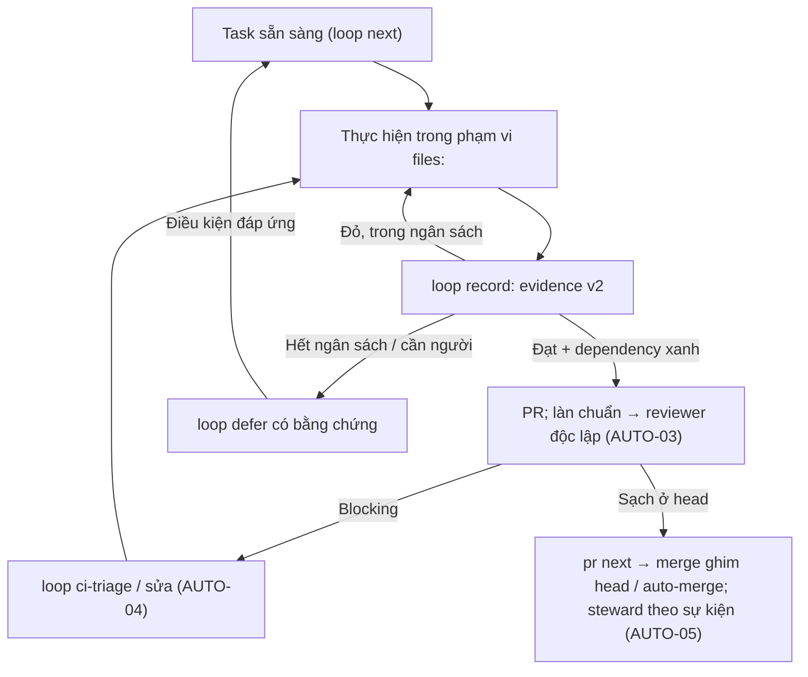

# Kế hoạch khắc phục và nâng cấp tự động hóa X-Templates

> Ngày: 2026-10-19 · Bản 2 (thay bản nháp #160) · Trạng thái: đề xuất đã tái hiện, kèm kế hoạch máy đọc
> [`PLAN-3.9-automation.md`](../autopilot/PLAN-3.9-automation.md) · Quyết định tự duyệt: D-066…D-070
> ([`DECISIONS.md`](../autopilot/DECISIONS.md)).
> Mục tiêu: tăng tối đa tỷ lệ việc máy tự hoàn tất (chọn task, thu bằng chứng, review, sửa CI, merge, nâng cấp) mà
> mọi kết luận "đạt" vẫn là bằng chứng máy kiểm được, không phải lời khai (P1).

## 1. Mốc đánh giá và cách dùng

Đánh giá kỹ thuật trên [v3.7.1, commit `9433792`][baseline]; bản 2 đối chiếu lại trên `main` `19d3aa8` (#158) ngày
2026-10-19 và **tái hiện lại từng phát hiện bằng lệnh** (§2). PR #159 (lát B của [PLAN](../autopilot/PLAN.md),
`T-1402…T-1408`) đang mở và sửa các lỗ guard cấp bách; bản này không lặp lại việc đó, chỉ nối tiếp.

[PLAN đang thực thi](../autopilot/PLAN.md) (3.8.0, `T-1401…T-1417`), [sổ audit](AUDIT-STATUS.md) và
[báo cáo delta](AUDIT-REPORT-2026-10-19-delta.md) vẫn là nơi theo dõi phát hiện đã có. Bản này bổ sung hướng sửa, nâng cấp
và **kế hoạch triển khai dạng máy đọc** cho đợt kế tiếp (3.9.0 → 3.10.0): khi vòng 3.8.0 phát hành, chạy
`python3 scripts/xt.py loop init --plan docs/autopilot/PLAN-3.9-automation.md --single-session` (D-067). Không dùng bảng
ở đây làm sổ hoàn thành thứ hai; chỉ cấp ID audit mới cho phần thật sự còn thiếu.

PR tài liệu không sửa mã, quyền, workflow, ruleset, phiên bản hay trạng thái sổ audit. CLI/schema/hook mang nhãn
**đề xuất** chưa tồn tại; mỗi thay đổi hành vi là một PR riêng theo [§8](#8-definition-of-done-cho-từng-pr-triển-khai).

## 2. Tái hiện lại trên `19d3aa8` (2026-10-19)

Chạy trực tiếp hàm trong `scripts/xt.py` (Python 3, thư mục gốc repo). Cột "Mức" là mức tin cậy của bằng chứng, không
phải mức nghiêm trọng: **đo** = lệnh chạy ra kết quả sai; **đọc** = kết luận từ đọc mã, chưa chạy.

| Mục | Lệnh / đầu vào | Kết quả | Mức |
|---|---|---|---|
| REC-01 | `same_command('test "$X" = yes', "test '$X' = yes")` | `True` — hai lệnh khác nghĩa shell bị coi là một | đo |
| REC-02 | `_verdict_blueprint` khi file blueprint đã khai không còn tồn tại | trả `done` kèm lý do "không thấy blueprint" (mã dòng 1145–1152); `_still_open` bỏ qua MUST mở | đọc |
| REC-03 | `merge_decision(pr làn chuẩn, L3, CI xanh, không review)` → `merge`; `pr_next` cùng dữ liệu → `review` | hai hàm hai điều kiện; steward dùng `pr_next` nên đường steward đúng, đường `merge-check`/guard không ép review | đo (hàm) |
| REC-04 | `apply_policy` ánh xạ `ask` → deny theo chuỗi trong `DANGER_MARKERS` (guard.py 3945–3973) | PR #159 (chưa merge) thêm dấu "shell lồng quá sâu" vào danh sách — sửa đúng lỗ, giữ cơ chế so chuỗi | đọc |
| REC-06 | `carry_states(cũ: "Coverage ≥ 80 % … — Bằng chứng: coverage --fail-under=80", mới: "Coverage ≥ 90 %")` | mục mới thành `[x]` mang nguyên bằng chứng 80 %, `dropped=[]` — không cảnh báo | đo |
| REC-07 | `audit_rescan`: nhóm `N/A` bị `continue` (mã dòng 2280–2300) | thêm UI sau khi audit không tạo yêu cầu quét A11Y | đọc |
| REC-08 | `merge_decision(rollup: quality=SKIPPED, merge-gate=SUCCESS; missingRequired=[])`, L3 | `merge` — "làn nhanh, CI xanh"; SKIPPED không thuộc nhóm nào, `missingRequired` chỉ tính check **vắng** | đo |
| REC-09 | `install.merge_permissions` gỡ `ask` trùng `OLD_FRAMEWORK_ASK` (install.py 163–182) | rule do dự án tự đặt trùng chuỗi bị gỡ theo | đọc |

Test cục bộ: `python3 -m unittest discover -s tests` trên `19d3aa8` → 788 test OK (báo cáo delta, CI run [quality][quality-run]).
Một fixture (`ProjectDirTest.test_no_marker_falls_back_to_cwd_and_env_wins`) nhạy với marker Git ở thư mục cha của `/tmp`
trong một môi trường; cô lập fixture ở PR test riêng (§9), không suy ra lỗi sản phẩm.

## 3. Nghiên cứu bổ sung (nguồn sống, đọc 2026-10-19)

Các dữ kiện dưới đây đổi cách thiết kế ở §4–§5; mỗi dòng ghi nguồn và ngày để rà lại khi triển khai.

| Dữ kiện | Ảnh hưởng | Nguồn |
|---|---|---|
| Required status check được thỏa khi check ở trạng thái `success`, `skipped` **hoặc** `neutral`; có thể đòi đúng app phát check | REC-08: "đã thực thi" phải mô hình hóa riêng; cấu hình tin cậy ghi tên check + app | [GitHub protected branches][checks-source] |
| Merge queue đòi workflow xử lý sự kiện `merge_group`; `pull_request` không đủ; cấu hình trong ruleset | AUTO-05: chưa bật merge queue (CI hiện không có `merge_group`); ghi làm bước sau | [GitHub merge queue][queue-source] |
| Actions: ghim action theo SHA; lockfile workflow "mạnh hơn SHA pinning" cho repo đã dùng; OIDC thay bí mật dài hạn; `workflow_run` thay `pull_request_target` khi cần tách đặc quyền | AUTO-03/05: workflow reviewer dùng OIDC/WIF, SHA pin; lockfile workflow (preview 10/2026, **chưa xác minh** điều kiện gói) ghi theo dõi | [GitHub Actions secure use][actions-source] |
| Hook Claude Code mới: `PermissionRequest` (chạy cả headless; không có quyết định ⇒ **deny**), `TaskCompleted` (exit 2 ⇒ task không được đánh dấu xong), `SubagentStop` (block ⇒ subagent làm tiếp), `PostToolUseFailure`, trường `if` lọc theo cú pháp rule, `onFailure: block` (v2.1.295+), `async`, loại hook `prompt`/`agent` (LLM) trả `{ok, reason}` | REC-04: typed decision có nhà ở `PermissionRequest`; AUTO-02: cổng bằng chứng ở mức task/subagent bằng command hook (D-068); `onFailure: block` thỏa `LOOP-DESIGN-010`; `prompt`/`agent` chỉ bổ trợ (lời khai) | [Claude Code hooks][hooks-source] |
| Headless: `--permission-prompts none`, `--max-budget-usd`, `--output-format json --json-schema` (kết quả có schema trong `structured_output`), `system/init` có `plugin_errors`/`mcp_server_errors`; `--bare` **sẽ thành mặc định của `-p`** trong bản tương lai | AUTO-01/03/04: điều phối và reviewer đọc JSON có schema; `LOOP-CI-010/014` cần cổng CI kiểm hook đã nạp (sự kiện `hook_response`) để không mất cổng khi `--bare` thành mặc định | [Claude Code headless][headless-source] |
| `claude-code-action@v1`: chế độ tự động khi có `prompt`; kiểm actor có quyền ghi, chặn bot (`allowed_bots`); fork PR không có secret; xác thực OIDC federation (`anthropic_federation_rule_id`…, cần `id-token: write`) | AUTO-03: reviewer chạy trong Actions với danh tính và token riêng, không chạy trên fork | [Claude Code GitHub Actions][gha-source] |
| Code Review (sản phẩm): chỉ Team/Enterprise; check run **không bao giờ fail**; chỉ đọc; không approve/block | Không dùng làm cổng bắt buộc; reviewer độc lập phải tự dựng (D-069); có thể bật thêm như lớp phụ nếu tổ chức đủ điều kiện | [Claude Code Code Review][review-source] |
| Routines (research preview): trigger `pull_request.*`/`release`, API `/fire`, lịch ≥ 1 giờ; chạy không hỏi quyền, clone mới, push nhánh `claude/`; trần sự kiện theo giờ; chạy dưới danh tính GitHub của chủ tài khoản | AUTO-05: Routine là đường kích phiên agent cho hành động steward không làm được (`review`, `fix`, `update` thiếu token); vì danh tính là chủ repo, review từ Routine **không** được tính là độc lập với tác giả | [Claude Code routines][routines-source] |
| `/loop` trong phiên: ≤ 50 task, hết hạn 7 ngày, chỉ chạy khi phiên mở; Monitor thay poll | `merge-watch` 30 s/lần (ADR-0021) giữ cho phiên; ngoài phiên dùng steward/Routine | [Claude Code scheduled tasks][loop-source] |
| Agent SDK (Python/TypeScript) có hook, subagent, session, permission callback; `claude -p` là đường chính thức cho ngôn ngữ khác | D-070: `xt.py` giữ stdlib, gọi `claude -p` như subprocess | [Agent SDK overview][sdk-source] |

## 4. Nguyên tắc thiết kế và danh mục ưu tiên

Ba nguyên tắc (giữ từ bản 1, bổ sung cơ chế thật):

- **Mỗi lần chuyển trạng thái có điều kiện máy kiểm được.** Thiếu blueprint đã khai, bằng chứng cũ, review chưa hợp lệ
  ⇒ tạo việc, không suy ra đạt. Cơ chế: `loop status`/`loop verify` (đĩa), `TaskCompleted`/`SubagentStop` hook (phiên),
  `merge-gate` (GitHub).
- **Tự sửa trong phạm vi được giao, có ngân sách.** Phân loại lỗi sản phẩm / môi trường / tạm thời; trần thử, thời gian,
  chi phí lưu trong `state.json`; hết thì `loop defer` và làm task độc lập khác.
- **Một chính sách, nhiều điểm thực thi.** CLI, hook, `merge-gate`, steward dùng **cùng hàm** quyết định; dữ liệu review/CI
  đọc theo repo/PR/head từ nguồn xác thực (app/danh tính), không từ tham số tự khai.

Giữ Python ≥ 3.11 stdlib, cổng `xt.yaml` (mypy --strict, coverage dòng + nhánh 100 %, lint), CI 3.11/3.13 (D-070).

| Mục | Ưu tiên | Kết quả mong muốn | Quan hệ với PLAN 3.8.0 | Task 3.9 |
|---|---|---|---|---|
| REC-01 | P1 | Không tái dùng kết quả giữa hai lệnh shell khác nghĩa; `-k` chạy 0 test (unittest 3.11) là đỏ | mới | T-1501, T-1502 |
| REC-02 | P1 | Mất/hỏng blueprint đã khai không thành `done`, sàn Gate giữ | mới | T-1503 |
| REC-08 | P1 | Check bắt buộc phải **thực thi** và SUCCESS đúng nguồn, đúng SHA | mở rộng T-1409 | T-1504 |
| REC-06 | P1 | Bằng chứng gắn revision nội dung yêu cầu | mới | T-1505 |
| REC-03 | P1 | Một điều kiện merge/review dùng chung; nguồn review xác thực | mở rộng T-1408/1409/1411 (AUD-SEC-069, HAR-058/059) | T-1507, T-1508 |
| REC-04 | P1 | Guard trả quyết định có kiểu + mã lý do; headless qua `PermissionRequest` | mở rộng T-1402 (AUD-SEC-063/070) | T-1509 |
| REC-07 | P2 | N/A được đánh giá lại khi khả năng dự án đổi | mới | T-1506 |
| REC-09 | P2 | Installer có kế hoạch/manifest, giữ quyền riêng của dự án | mới | T-1516 |
| REC-05 | P2 | Yêu cầu bảo mật thiết yếu không bị trần MUST hạ | mới, cần ADR | T-1519 |
| REC-10 | P2 | Tài liệu một nhà cho chính sách tự chủ | gộp T-1415 | T-1520 |
| REC-11 | P2 | Gói ngữ cảnh theo task, đo byte thật | mới | T-1512 |
| REC-13 | P2 | Registry nguồn: phân loại lỗi tạm/đổi/hết hiệu lực | AUD-CI-011 | T-1520 |
| REC-12 | P3 | Tách dần `xt.py`/guard sau khi có kiểm bất biến | AUD-ARCH-001 | ngoài 3.9 |

Việc đã có trong T-1403…1414 tiếp tục theo PLAN hiện hữu; vắng mặt ở đây không có nghĩa là giảm ưu tiên.

## 5. Gói khắc phục (REC) — hướng sửa đã chốt

### REC-01 — Danh tính lệnh và `-k` rỗng

**Sửa:** `same_command` so **chuỗi chuẩn hóa giữ ngữ nghĩa shell**: chỉ gộp khoảng trắng ngoài nháy; nháy đơn và nháy kép
khác nhau khi phần trong nháy chứa `$`, `` ` ``, `\`, `!`; evidence ghi thêm `cmd_sha256` của chuỗi gốc. `loop record`/`loop
verify` đọc dòng khớp `^Ran 0 tests` của unittest — **exit 0 kèm 0 test ⇒ coi là đỏ** (`zero_tests_red`). Phạm vi: unittest
trên Python 3.11 exit 0 khi không chọn được test (tái hiện 2026-10-19; 3.12+ exit 5, pytest exit 5 — giữ nguyên là đỏ); các
runner khác exit 0 khi 0 test (go/cargo/jest) xử lý theo mẫu đầu ra riêng khi gặp. Không bắt chuỗi `0 passed` (khớp nhầm
`10 passed`). Gate dạng `-k <tên>` khi test chưa tồn tại là xanh giả (DoD §8 mục 2).

**Nghiệm thu:** cặp lệnh ở §2 chạy riêng, tổng kiểm đỏ; ca glob, escape, env, thư mục khác; evidence cũ không có
`cmd_sha256` giữ để truy vết nhưng `verify` chạy lại; bí mật vẫn che trong log.

### REC-02 — Hợp đồng phạm vi suốt vòng lặp

**Sửa:** `loop init` ghi `scope` vào `state.json` (`blueprint`, `profile`, `scale`, `rev` = sha256 phần mục của
blueprint, `gate_floor` đã tính). `_verdict_blueprint`: file mất/hỏng ⇒ `verify` kèm lý do, không `done`; sàn Gate
đọc từ `scope` khi file không đọc được. Đổi scope bằng `loop init --force` có chủ đích (LOOP-HARNESS-024), không suy
từ việc xóa file.

**Nghiệm thu:** mất file, đổi tên, frontmatter hỏng, đổi scale; không ca nào rơi về `done`/S; khôi phục file ⇒ tiếp tục;
dự án không khai blueprint từ đầu giữ hợp đồng riêng; migration state cũ không reset task.

### REC-03 — Một điều kiện merge, review có nguồn xác thực

**Sửa:** hàm thuần `merge_eligibility(pr, rec, policy)` trả `{eligible, lane, needs: [review|ci|update|human], head}`;
`merge_decision`, `pr_next`, `merge-gate`, guard MCP/`gh` và steward đều gọi nó (hợp đồng một hàm, test đặc tính chéo).
`merge-gate` đỏ khi auto-merge đang bật mà `needs` còn `review` ở head hiện tại (mở rộng ADR-0023 bằng ADR mới).
Review hợp lệ = dấu `xt-review v1` **do danh tính reviewer đã cấu hình** (`xt.yaml review_identity:` — app/PAT riêng,
D-069) đăng, đúng `head`, mới hơn mọi review chặn ở head đó; họ model của tác giả và reviewer khai cố định trong `xt.yaml`
(`author_model_family:`, `reviewer_model_family:`) vì PR không mang dữ liệu model (`ai_attribution: forbid`) — `ci-check`
từ chối hai họ trùng (D-045); marker do tác giả/chủ repo đăng tay chỉ được tin khi
`review_identity` chưa cấu hình (chế độ hiện hành, ghi cảnh báo). Blocking ở head hiện tại thắng review sạch mang
sang (T-1411). Kiểm head ngay trước merge, ghim SHA (đã có).

**Nghiệm thu:** chưa review, review cũ, blocking ở head, push sau khi bật auto-merge, đổi repo/PR, review sai thứ tự,
giả nguồn, cập nhật base; `merge-gate` IN_PROGRESS không tự chờ chính nó; xanh ở base/head cũ không dùng cho head mới.

### REC-04 — Guard trả quyết định có cấu trúc

**Sửa:** `Decision(action: allow|deny|ask, code: str, confidence: sure|unsure, missing: list)`; mã lý do là hằng
(`PUSH_MAIN`, `WIPE_OUTSIDE`, `NEST_TOO_DEEP`, `BRACE_OVERFLOW`, `SECRET_EXFIL`, `EVIDENCE_HANDWRITE`, `REVIEW_FORGE`,
`UNPARSED`, `BUDGET`…). `apply_policy` ánh xạ theo `code` (bảng), không theo chuỗi; `UNPARSED`/`BUDGET`/`unsure` với hành
động thuộc nhóm chặn ⇒ deny ở mọi adapter (bash/mcp/edit). Hook `PermissionRequest` (command) trả
`hookSpecificOutput.decision` từ cùng `Decision` cho phiên headless (không có quyết định ⇒ Claude Code deny — chiều chặt).
Regex/hook cùng UID không được mô tả là ranh giới cách ly (giữ ghi chú D-015).

**Nghiệm thu:** cùng hành động qua Bash/MCP/hook/headless cho cùng kết quả; test chính sách mặc định, strict, lồng shell,
parse lỗi, alias; corpus lệnh hợp lệ (`tests/test_guard_corpus.py`) không tăng chặn oan.

### REC-05 — Tính áp dụng, mức thiết yếu, mức bảo đảm

**Sửa:** ADR mới về selection semantics: mục có `essential: true` (trong frontmatter mục hoặc bảng của module) **không
bị trần 4 MUST/module ở M** khi feature fact tương ứng bật (`auth`, `jwt`, `oauth`, `reset`, `payment`, `pii`); scale quyết
định độ sâu bằng chứng. Thí điểm trên `08-backend/authn-authz.md` (BE-AUTH-003/006/008/015), đối chiếu [RFC 8725][jwt-source]
và [OWASP Authentication][auth-source] lúc làm.

**Nghiệm thu:** fixture S/M/L có/không auth, JWT, OAuth, reset; báo cáo diff MUST/SHOULD; recompose hai lần ổn định;
không bỏ trần đại trà.

### REC-06 — Bằng chứng có revision của yêu cầu

**Sửa:** `carry_states` so **phần quy phạm** (chữ sau mức, trước ` · Nguồn:`) đã chuẩn hóa: đổi ⇒ trạng thái về `[ ]`,
ghi chú cũ giữ dưới nhãn `— Cũ (rev <7 ký tự>): …`, ID vào danh sách `stale`; `compose` in báo cáo `stale` và
`blueprint-status` cảnh báo. Sửa chính tả/link (chỉ khác sau chuẩn hóa dấu câu/khoảng trắng/URL) giữ trạng thái.

**Nghiệm thu:** 80→90 với 85 ⇒ mở; đổi phạm vi làm `[x]`/`[~]` cũ mất hiệu lực; mục mới mở; recompose ổn định; không
xóa lịch sử.

### REC-07 — N/A phụ thuộc phạm vi hiện tại

**Sửa:** `audit rescan` chạy `audit_applicability(signals)` hiện tại; nhóm `N/A` mà tín hiệu nay bật (UI, DB, auth, AI,
harness) ⇒ "N/A→áp dụng, cần quét"; `audit check --strict` đỏ tới khi có dòng quét hoặc giải trình mới (`N/A` kèm lý do
nhắc tín hiệu). Tín hiệu phần mở rộng là gợi ý; ví dụ/fixture được giải trình.

### REC-08 — Check thành công ≠ check không thực thi

**Sửa:** `_pr_rest` lấy danh sách check bắt buộc (đã có `_required_checks`) và **app** của từng check; `_ci_buckets` trả
thêm `not_run` = check bắt buộc ở `SKIPPED`/`NEUTRAL`/`CANCELLED`/`STALE` hoặc do app khác phát; `_merge_blockers` ⇒
`human` ("check bắt buộc không thực thi"). `merge-gate` và check chính sách khác không là bằng chứng CI (T-1409).

**Nghiệm thu:** missing, pending, cancelled, failure, skipped, neutral, sai app, SHA cũ, tất cả SUCCESS; không vòng chờ
giữa required gate.

### REC-09 — Nâng khung có kế hoạch thay đổi quyền

**Sửa:** `install.py --plan` in JSON diff (quyền thêm/bớt, hook thêm/đổi matcher, file đè); manifest
`.xtemplates/manifest.json` ghi hash từng file/rule khung đã cài; chỉ gỡ `ask` khi manifest chứng minh rule do khung
đặt; rule trùng chuỗi nhưng không có trong manifest ⇒ giữ và báo. Lựa chọn chính sách lưu trong manifest, không hỏi lại.

### REC-10…13 — Tài liệu, ngữ cảnh, cấu trúc, nguồn

- **REC-10:** `framework/11-autonomous-loop/stop-points-and-escalation.md` là nhà chính sách tự chủ; README/skill/template
  chỉ tóm tắt + liên kết; số đếm sinh bằng `xt.py stats` (AUD-DOC-048).
- **REC-11:** `xt.py context --task T-xxx --json` (đề xuất) in gói ngữ cảnh: ID yêu cầu của task, đoạn spec, Gate, file
  trong phạm vi, số byte; web S/M/L có 70/473/1.146 MUST, blueprint web M 229.794 byte (đo tại mốc) — đo trước khi đặt
  mục tiêu tiết kiệm.
- **REC-12:** sau khi có test bất biến chéo (`merge_eligibility`, `Decision`), tách `xt.py` theo vùng đang thay; giữ tên
  lệnh/exit code/JSON. Ngoài 3.9.
- **REC-13:** `check-links.py --external` (đề xuất) + `links.yml`: phân loại 5xx/timeout (tạm), 301/404 (đổi/chết),
  403/429 (chưa xác minh nội dung); retry hữu hạn; `research/` ghi ngày rà lại.

## 6. Nâng cấp tự động hóa (AUTO) — cơ chế thật

X-Templates đã có vòng lặp có bằng chứng, `pr next`, steward, `merge-gate`, guard không hỏi. Các gói dưới nối chúng
bằng hợp đồng máy đọc và bỏ điều phối tay. Bảng ghi **cơ chế cụ thể** đã đối chiếu nguồn §3.

| Gói | Tự động hóa thêm | Cơ chế | Điều kiện chất lượng | Task |
|---|---|---|---|---|
| AUTO-01 — Task có phụ thuộc, gói ngữ cảnh | Chọn task sẵn sàng, giao song song khi không giao nhau file; không tick task khi dependency chưa xanh | PLAN thêm `(sau: T-a, T-b; files: a/*, b.py)` — parser hiện bỏ qua; `loop next --json` trả tập sẵn sàng + cặp giao nhau; `loop record` từ chối tick khi dependency mở; `xt.py context` (REC-11) | Feature fact chưa rõ ghi "chưa biết"; worktree riêng cho task giao nhau (LOOP-ORCH-010) | T-1511, T-1512 |
| AUTO-02 — Thu và làm mới bằng chứng | Bằng chứng tự hết hiệu lực khi đầu vào đổi; verify chỉ chạy lại phần đổi | evidence v2: `cmd_sha256`, `scope`, `req_rev`, `files_digest` (sha256 cây của `files:`); `loop verify` chạy lại Gate có digest đổi, giữ Gate không đổi (vẫn chạy toàn bộ khi `--all`); hook `TaskCompleted` (exit 2 khi `TaskUpdate` đánh dấu xong mà không có evidence xanh cho `T-` trong subject) và `SubagentStop` (block khi báo cáo executor thiếu "lệnh + exit code") | REC-01/02/06/07; bí mật che; không tick tự khai | T-1513, T-1514 |
| AUTO-03 — Review tự động độc lập | PR làn chuẩn được review mà không cần phiên tác giả; phát hiện có schema; sửa và review lại head mới tự động | Workflow `pr-review.yml`: `claude-code-action@v1` (SHA pin, OIDC/WIF hoặc token reviewer riêng), `prompt: /review`, `claude_args: --json-schema <findings> --model <họ reviewer_model_family trong xt.yaml> --max-turns --max-budget-usd`; job đọc `structured_output`, chạy `pr reviewed --clean|--blocking` bằng **danh tính reviewer** (`XT_REVIEWER_TOKEN`, D-069); `published_reviews` chỉ tin danh tính này khi `review_identity` cấu hình; blocking ⇒ `pr next` = `fix` ⇒ Routine/phiên agent sửa | REC-03/08; reviewer không có quyền ghi nhánh; không chạy trên fork; tác giả không tự tạo review sạch; họ model khai trong `xt.yaml`, khác tác giả (D-045) | T-1508 |
| AUTO-04 — Sửa CI trong ngân sách | Phân loại lỗi, sửa nhỏ, chạy lại kiểm liên quan, rồi cổng đầy đủ | `loop ci-triage --run <id> --json`: đọc log job qua `gh`, phân loại hạ tầng/test/lint/type/coverage/secret/migration theo bảng `self-healing-ci.md`; `state.json.episode` lưu `rerun_used`, `fix_attempts`, `cost_usd` (chưa đo ⇒ `null`); cùng chữ ký 3 lần ⇒ `defer`; secret/SAST ⇒ `block` | Không nới test/threshold/ruleset; re-run ≤ 1; ngân sách sống qua restart | T-1515 |
| AUTO-05 — Steward theo sự kiện, phục hồi | Reconcile ngay khi check/review/head đổi; cron là bù; restart không lặp tác dụng phụ | `pr-steward.yml` thêm `check_suite: completed`, `workflow_run` (quality/merge-gate completed), `pull_request_review: submitted` (**cần xác minh** ngữ cảnh checkout của sự kiện này trước khi thêm; mặc định chỉ `check_suite`/`workflow_run`); mọi hành động idempotent theo (repo, PR, head, hành động) đọc trạng thái GitHub trước khi làm (auto-merge flag, nhãn); Routine GitHub trigger `pull_request.synchronize` kích phiên agent cho `review`/`fix`/`update` khi thiếu `XT_STEWARD_TOKEN` | REC-03/04/08; khóa thao tác; refresh head trước thực hiện | T-1517 |
| AUTO-06 — Nâng cấp và drift có kiểm chứng | Dự án đích thấy lệch cấu hình/tài liệu/quyền và nhận PR nâng cấp trong phạm vi | `install.py --plan`/manifest (REC-09); `doctor --drift --json` so manifest với bản cài và tag mới nhất; Routine tuần ở dự án đích mở PR nâng cấp từ plan | Giữ tùy chỉnh; không đổi ruleset/production | T-1516, T-1518 |
| AUTO-07 — Đánh giá tự chủ trước khi mở rộng | Bộ task chuẩn + corpus false-green chạy lại khi sửa policy/harness | `xt.py autonomy-bench --json`: corpus PR/rollup/review/guard fixture (mọi tái hiện §2, audit 🔴/🟠 đã sửa, ca đối kháng do reviewer khác model thêm) — exit 1 khi false-green > 0; `docs/ops/AUTONOMY-BASELINE.md` ghi cấu hình, revision, số đo; CI chạy ở job `quality` | Ca đối kháng do reviewer khác model viết, không phải tác giả bản sửa; kết luận giới hạn trong tập đã kiểm | T-1521 |

### Thang tự chủ theo loại thay đổi (mục tiêu sau đợt 3.9/3.10)

| Loại PR | Hiện nay | Mục tiêu | Điều kiện cứng |
|---|---|---|---|
| Tài liệu ngoài `merge_risk_paths` | Làn nhanh, auto-merge khi mở | Giữ | CI xanh (REC-08), `merge-gate` |
| Mã công cụ (`scripts/*`, `framework/11-*`, `templates/*`, ADR) | Làn chuẩn: review subagent trong phiên tác giả rồi `pr reviewed` | Reviewer độc lập (AUTO-03) tự chạy, tự `pr reviewed`; blocking ⇒ sửa tự động (AUTO-04) rồi review lại; sạch ⇒ auto-merge | Danh tính reviewer riêng; model khác họ; corpus guard/merge xanh |
| Hook/guard/settings (`.claude/*`) | Như trên + lý do trong PR | Như trên + `autonomy-bench` 0 false-green là required | Không nới chặn; chặn oan không tăng |
| Ngoại lệ cứng (ADR-0020 `auto`) | Agent merge như PR khác | Giữ; thêm `merge-gate` đòi review hợp lệ ở head (REC-03) | `merge_hard_exceptions: human` ⇒ người (không đổi) |
| Ủy quyền production, tiền/dữ liệu thật | Người | Người | `grant-check` (ADR-0022) |

### Hợp đồng tối thiểu cho bộ điều phối

Task: ID ổn định · ID yêu cầu · `sau:` (dependency) · `files:` (phạm vi ghi) · Gate lệnh máy · ngân sách · thao tác bù.
Validator (`loop status`) kiểm cú pháp, chu trình dependency, cặp giao nhau file, Gate chạy được. Gate chưa chứng minh
quan hệ với acceptance phải được reviewer rà trước khi dùng làm điều kiện hoàn tất (`LOOP-ORCH-018`). Schema là đề
xuất: chốt ADR trước khi đổi parser (`TASK_RE` giữ tương thích — phần mở rộng nằm trong ngoặc của `rest`).

Tự sửa CI kế thừa [giới hạn hiện hành](../../framework/11-autonomous-loop/self-healing-ci.md): rerun ≤ 1 cho lỗi nghi hạ
tầng; cùng chữ ký 3 lần ⇒ dừng episode; ngân sách sống qua restart; thiếu số đo chi phí ⇒ `null`, không ghi 0.

### Chỉ số và tiêu chí mở rộng

| Chỉ số | Cách tính (nguồn máy) |
|---|---|
| Tỷ lệ tự hoàn tất | `loop stats`: task xanh không `defer`/can thiệp ÷ task đủ điều kiện; báo riêng defer |
| Can thiệp thủ công | Số lần người sửa PLAN/môi trường/review/phục hồi mỗi task (`runs.jsonl` + PR comment) |
| Chất lượng lọt | Lỗi sau merge theo mức (sổ audit); mọi false-green ⇒ fixture vào `autonomy-bench` |
| Review và bằng chứng | Tỷ lệ merge có review hợp lệ cùng head + check bắt buộc thực thi = 100 % trong corpus |
| Tốc độ và chi phí | Trung vị/P95 thời gian mở PR → merge (`gh`), lượt sửa, `total_cost_usd` từ `claude -p` khi có |
| Chặn oan / phục hồi | Corpus `test_guard_corpus.py`; tỷ lệ restart đúng bước (fixture AUTO-05) |

Baseline tại mốc (`9433792`, CI [quality][quality-run]): 788 test, coverage 100 %, cổng 150,5 s; PR #94–#157 merge theo làn
với steward, số lần merge tay chưa đo — `T-1521` đo trước khi bật AUTO-03/04 thật. Mục tiêu số đặt sau pilot.

## 7. Thứ tự triển khai và điểm kiểm soát

Kế hoạch máy đọc: [`PLAN-3.9-automation.md`](../autopilot/PLAN-3.9-automation.md) (T-1501…T-1522, Gate từng task, 4 con
số, điểm dừng; `sau:` là dependency trong file, `cần:` là điều kiện ngoài file). Tóm tắt:

| Đợt | Task | Phụ thuộc | Điều kiện sang đợt tiếp |
|---|---|---|---|
| 1 — Kết luận đạt đáng tin | T-1501…T-1506 (REC-01/02/06/07/08, `-k` rỗng) | 3.8.0 đã phát hành (`main` có #159 và T-1417) | test đỏ trước/xanh sau cho mọi tái hiện §2 (các test này là hạt nhân corpus của T-1521) |
| 2 — Review/merge nhất quán | T-1507…T-1509 (REC-03/04, AUTO-03) | đợt 1; T-1408/1409/1411 đã merge | `merge_eligibility` dùng chung 5 điểm; corpus guard xanh; workflow reviewer `ci-check` xanh (chạy thật cần `XT_REVIEWER_TOKEN` — `loop defer`) |
| Phát hành 3.9.0 | T-1510 | đợt 1–2 | CHANGELOG, VERSION 3.9.0 (Gate kiểm), tag qua `release-tag.yml` |
| 3 — Bằng chứng và điều phối | T-1511…T-1515 (AUTO-01/02/04, hook mới, REC-11) | 3.9.0 (evidence v2 cần REC-01/02/06) | fixture DAG/giao nhau; hook test payload giả; `ci-triage` fixture 4 loại lỗi |
| 4 — Steward, nâng cấp, đánh giá, yêu cầu | T-1516…T-1521 (AUTO-05/06/07, REC-05/09/10/13) | đợt 2–3 | fixture phục hồi/event lặp; manifest; `AUTONOMY-BASELINE.md`; ADR selection |
| Phát hành 3.10.0 | T-1522 | đợt 3–4 | như trên; dự án đích chạy lại `install.py` |

Mỗi task một PR nhỏ (nhánh theo ràng buộc phiên, D-065). Pilot AUTO-03/04/05 ở chính repo khung trước, rồi
`seeker19110/hotel-manager` ([TARGETS](TARGETS.md)) ở chế độ chỉ-lập-quyết-định (`--json`, không `--apply`) một tuần, so với
kết quả mong đợi, rồi mới bật ghi/merge.

## 8. Definition of Done cho từng PR triển khai

1. Ghi rõ REC/AUTO và AUD/T tương ứng, commit tái hiện, phạm vi file, hành vi sau sửa.
2. Lỗi tái hiện có test đỏ trước/xanh sau; thêm ca hợp lệ chống chặn oan. Test/schema/CLI mới chạy thật; Gate `-k`
   chạy 0 test không phải bằng chứng (T-1501 làm máy chặn điều này).
3. `scripts/dev-task.sh gate` xanh theo `xt.yaml` và CI bắt buộc trên head PR; không đổi threshold.
4. Đổi policy/state/selection/evidence ⇒ ADR mới + migration tương thích; state cũ đọc được hoặc "cần xác minh lại".
5. CHANGELOG; hướng dẫn cài lại/recompose; số thống kê sinh lại.
6. Review theo làn trên đúng head; review độc lập không suy ra từ coverage hay số reviewer.
7. Đường lùi: revert bằng PR; không bật lại đường cho qua đã xác nhận lỗi.
8. Sổ audit chỉ sang "đã sửa" khi có PR/commit + lệnh chứng minh.

## 9. Điểm còn cần xác minh khi thực thi

- REC-03/08: kết quả giả lập chứng minh quyết định không nhất quán, chưa chứng minh sự cố merge thật; chạy kiểm tích hợp
  có kiểm soát (race, nguồn check/review, cập nhật base) trước khi đóng.
- Fixture `test_no_marker_falls_back_to_cwd_and_env_wins`: cô lập khỏi marker Git ở thư mục cha (dùng `tempfile` ngoài
  cây Git hoặc `GIT_CEILING_DIRECTORIES`) trong PR test riêng.
- Ngữ cảnh checkout của `pull_request_review`/`check_suite` cho steward (AUTO-05): xác minh trên tài liệu sự kiện GitHub
  trước khi thêm trigger; giữ nguyên tắc không checkout mã PR.
- Lockfile workflow GitHub Actions (preview 10/2026): điều kiện gói và cú pháp **chưa xác minh** từ docs.github.com; chỉ
  áp dụng khi xác minh được, SHA pin vẫn là tối thiểu.
- `--bare` thành mặc định của `-p`: thêm bước CI kiểm `hook_response` của `SessionStart` trước khi dựa vào hook trong
  headless (LOOP-CI-014).
- Routines chạy dưới danh tính chủ tài khoản: không dùng làm reviewer độc lập; chỉ kích `fix`/`update`.
- Hook `prompt`/`agent`: không là bằng chứng; chỉ dùng cho nhắc nhở (ví dụ Stop nhắc còn task), có `timeout`.
- `docs/autopilot/PLAN*.md` chứa lệnh Gate mà harness chạy nhưng `merge_lane_reasons` xếp làn nhanh (review bản 2 tái hiện:
  PR chỉ sửa file này → `[]`); T-1511 đưa vào `merge_risk_paths`.

## 10. Nguồn và dấu vết

Liên kết mã ghim vào commit đánh giá để số dòng không trôi; nguồn ngoài đọc 2026-10-19.

[baseline]: https://github.com/seeker19110/X-Templates/commit/943379215343a4eb537a880f1ed94231774ac1cd
[quality-run]: https://github.com/seeker19110/X-Templates/actions/runs/39230998060/job/117988638558
[checks-source]: https://docs.github.com/en/repositories/configuring-branches-and-merges-in-your-repository/managing-protected-branches/about-protected-branches#require-status-checks-before-merging
[queue-source]: https://docs.github.com/en/repositories/configuring-branches-and-merges-in-your-repository/configuring-pull-request-merges/managing-a-merge-queue
[actions-source]: https://docs.github.com/en/actions/reference/security/secure-use
[hooks-source]: https://code.claude.com/docs/en/hooks
[headless-source]: https://code.claude.com/docs/en/headless
[gha-source]: https://code.claude.com/docs/en/github-actions
[review-source]: https://code.claude.com/docs/en/code-review
[routines-source]: https://code.claude.com/docs/en/routines
[loop-source]: https://code.claude.com/docs/en/scheduled-tasks
[sdk-source]: https://code.claude.com/docs/en/agent-sdk/overview
[jwt-source]: https://www.rfc-editor.org/rfc/rfc8725
[auth-source]: https://cheatsheetseries.owasp.org/cheatsheets/Authentication_Cheat_Sheet.html

Mã nguồn tại mốc `9433792`: [`same_command`](https://github.com/seeker19110/X-Templates/blob/943379215343a4eb537a880f1ed94231774ac1cd/scripts/xt.py#L1212-L1217) ·
[`_verdict_blueprint`](https://github.com/seeker19110/X-Templates/blob/943379215343a4eb537a880f1ed94231774ac1cd/scripts/xt.py#L1145-L1152) ·
[`merge_decision`](https://github.com/seeker19110/X-Templates/blob/943379215343a4eb537a880f1ed94231774ac1cd/scripts/xt.py#L3422-L3486) ·
[`pr_next`](https://github.com/seeker19110/X-Templates/blob/943379215343a4eb537a880f1ed94231774ac1cd/scripts/xt.py#L5626-L5666) ·
[`apply_policy`](https://github.com/seeker19110/X-Templates/blob/943379215343a4eb537a880f1ed94231774ac1cd/.claude/hooks/guard.py#L3965-L3973) ·
[`carry_states`](https://github.com/seeker19110/X-Templates/blob/943379215343a4eb537a880f1ed94231774ac1cd/scripts/xt.py#L748-L776) ·
[`audit_rescan`](https://github.com/seeker19110/X-Templates/blob/943379215343a4eb537a880f1ed94231774ac1cd/scripts/xt.py#L2280-L2300) ·
[`_ci_buckets`](https://github.com/seeker19110/X-Templates/blob/943379215343a4eb537a880f1ed94231774ac1cd/scripts/xt.py#L3252-L3270) ·
[`merge_permissions`](https://github.com/seeker19110/X-Templates/blob/943379215343a4eb537a880f1ed94231774ac1cd/scripts/install.py#L163-L182) ·
[`_check_must_cap`](https://github.com/seeker19110/X-Templates/blob/943379215343a4eb537a880f1ed94231774ac1cd/scripts/xt.py#L411-L526) ·
[Run Links đã kiểm](https://github.com/seeker19110/X-Templates/actions/runs/39233814093/job/117997920837).
